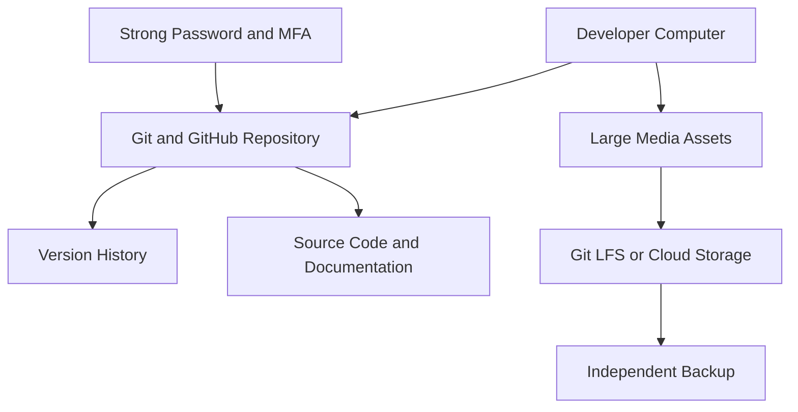

# Cloud Storage Architecture Diagram

## Explanation
- Developer Computer: edits source code and assets.
- GitHub Repository: stores tracked files and version history.
- Git LFS or Cloud Storage: planned storage for large binary files.
- Independent Backup: separate recovery copy.
- Strong Password and MFA: protects account access.

Note: Git LFS, external cloud storage, and independent backup are proposed components unless separately configured and verified.
