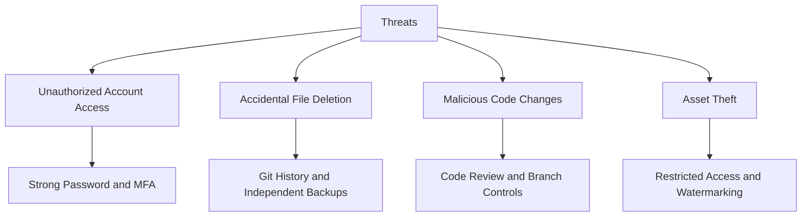

# Threat Model Diagram

## Purpose
This diagram links potential threats to planned mitigation measures.

## Important
These are proposed controls. Their actual configuration and effectiveness must be verified separately.
